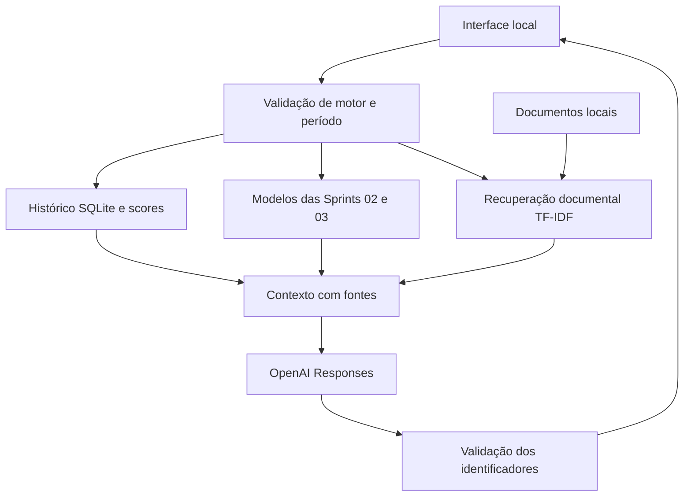

# Forzy - Assistente de manutenção com RAG

Solução acadêmica da Sprint 04: consulta de sensores, classificação de falhas, detecção de anomalias e respostas com fontes recuperadas de documentos locais.

**Os dados são sintéticos.** A base documental descreve os dados e os modelos; ela não contém manuais de fabricante. Também não há registros de manutenção realizada.

- [Documentação final em PDF](documentacao/Documentacao_final_Sprint_04.pdf)
- [Conferência dos dez requisitos](documentacao/REVISAO_ENTREGA.md)
- [Relatório em Markdown](documentacao/RELATORIO_FINAL.md)

## Equipe

| Integrante | RM |
| --- | --- |
| Lucca Phelipe Masini | 564121 |
| Luiz Henrique Poss | 562177 |
| Igor Paixão Sarak | 563726 |
| Bernardo Braga Perobeli | 562468 |
| Felipe Stefani Honorato | 563380 |

## Execução no Windows

Pré-requisitos: Python 3.13 e internet para instalar dependências e consultar a OpenAI. Para gerar respostas, use uma chave própria com acesso ao modelo e disponibilidade de uso. O consumo da API pode ser cobrado. Treinamento, busca e testes locais funcionam sem chamadas à API.

Depois de clonar este repositório ou extrair o ZIP, abra o PowerShell na pasta do projeto:

```powershell
python -m venv .venv
.\.venv\Scripts\python.exe -m pip install -r requirements-lock.txt
.\.venv\Scripts\python.exe preparar_projeto.py
.\.venv\Scripts\python.exe indexar_documentos.py
```

O repositório contém o banco sintético e o código para regenerar os modelos. O ZIP completo já inclui modelos e resultados; nesse caso, `preparar_projeto.py` apenas confirma a disponibilidade. O script só treina componentes cujos arquivos necessários estejam ausentes. Não modifica o banco.

Copie `.env.example` para `.env.local` e preencha `OPENAI_API_KEY` de forma privada. `OPENAI_MODEL` é opcional; o padrão é `gpt-4.1-mini`. Não publique esse arquivo nem inclua a chave em capturas ou mensagens.

```powershell
.\.venv\Scripts\python.exe app.py
```

Abra **http://127.0.0.1:8501**. Encerre com Ctrl+C. Para outra porta, use `app.py --porta 8502`. A aplicação escuta somente na máquina local e não inclui autenticação para publicação na internet.

## Uso

1. Selecione o motor e o período nos filtros.
2. Escreva uma pergunta ou escolha um exemplo.
3. Consulte a resposta e expanda as fontes na área Evidências.
4. Para analisar valores próprios, abra Nova leitura e preencha os quatro sensores.
5. Use Exportar conversa para salvar as consultas e evidências em JSON.

Período disponível: 01/01/2026 00:00 a 02/01/2026 00:59, sem fuso informado. Expressões como ontem não são convertidas automaticamente em datas. Uma pergunta com motor diferente do filtro solicita correção. A conversa mantém até seis mensagens em memória do navegador.

## Arquitetura



O RAG usa fragmentos de até 180 palavras, sobreposição de 30, TF-IDF com palavras e pares de palavras e similaridade de cosseno. Recupera até cinco trechos com similaridade mínima de 0,035. Não usa embeddings remotos nem banco vetorial externo. Essa pontuação não mede a probabilidade de uma resposta correta.

As fontes são identificadas por `O1` (operação), `C1` (leitura fornecida, quando houver) e `F1`, `F2` etc. (documentos). Os identificadores valem para cada resposta. São rejeitadas referências inexistentes, inclusive quando aparecem agrupadas. A checagem de identificadores não substitui a avaliação do conteúdo.

## Documentos

A pasta `base_documental` aceita Markdown, texto e PDF com camada textual. O manifesto define título e origem e pode incluir `motores`, `inicio` e `fim` para restringir a aplicação de uma fonte. Documentos sem restrições são gerais. A vigência documental é diferente do período das leituras.

O índice fica em memória e é reconstruído quando a aplicação é reiniciada. `indexar_documentos.py` exporta inventário, fragmentos e hashes para conferência. PDFs digitalizados exigem OCR antes da inclusão. Só adicione fontes conhecidas e pertinentes.

## Arquivos principais

| Arquivo ou pasta | Função |
| --- | --- |
| `app.py`, `web/` | Servidor e interface |
| `assistente.py` | Contexto, geração e validação das fontes |
| `operacao.py` | Consulta do histórico e integração dos modelos |
| `recuperacao.py` | Indexação e busca documental |
| `manutencao_modelo.py` | Classificador da Sprint 02 |
| `deteccao_anomalias.py` | Baseline e Isolation Forest da Sprint 03 |
| `preparar_projeto.py` | Regenera os modelos e resultados necessários |
| `motor.db` | Base sintética fornecida |
| `base_documental/` | Fontes e metadados |
| `testes/`, `evidencias/` | Verificações, resultados e capturas |
| `documentacao/` | Relatório, especificação e conferência da entrega |

Os arquivos `.joblib`, a pasta `dados_resultado`, ambientes virtuais e credenciais não são versionados. Eles não são necessários no histórico Git porque podem ser regenerados ou configurados localmente.

## Testes

```powershell
.\.venv\Scripts\python.exe -m unittest discover -s testes -v
```

A suíte local não chama a API. O registro da revisão está em `evidencias/testes_revisao.txt`. Os três cenários conversacionais exigidos estão documentados no PDF e em `evidencias/cenarios.json`, com as respostas reais, fontes e consumo registrados.

Para repetir esses três cenários, com consumo de API:

```powershell
.\.venv\Scripts\python.exe avaliar_cenarios.py
```

Para repetir os treinamentos completos, os comandos `python manutencao_modelo.py` e `python deteccao_anomalias.py` substituem os respectivos arquivos gerados. Preserve uma cópia se quiser manter resultados anteriores.

## Limitações

- Dados simulados, histórico curto e ausência de validação industrial externa.
- Sem ordens de serviço, trocas de peças, técnicos ou manuais de fabricante.
- Busca lexical sujeita a perder paráfrases e informações fora do corpus.
- Geração sujeita a erros mesmo quando os identificadores das fontes são válidos.
- Severidade estatística sem validação como escala de risco industrial.
- Sem ingestão contínua, autenticação multiusuário ou ações físicas sobre motores.

## Regeneração do PDF

O gerador usa Arial do Windows e evidências já existentes. Não chama a API.

```powershell
.\.venv\Scripts\python.exe -m pip install -r requirements-documentacao.txt
.\.venv\Scripts\python.exe gerar_documentacao.py
```

O PDF é gerado na pasta acima do projeto. A versão de entrega está em `documentacao/Documentacao_final_Sprint_04.pdf`.

## Referências

- [OpenAI: saídas estruturadas](https://developers.openai.com/api/docs/guides/structured-outputs)
- Documentação original da base e dos modelos, identificada em `base_documental/manifesto.json`.
